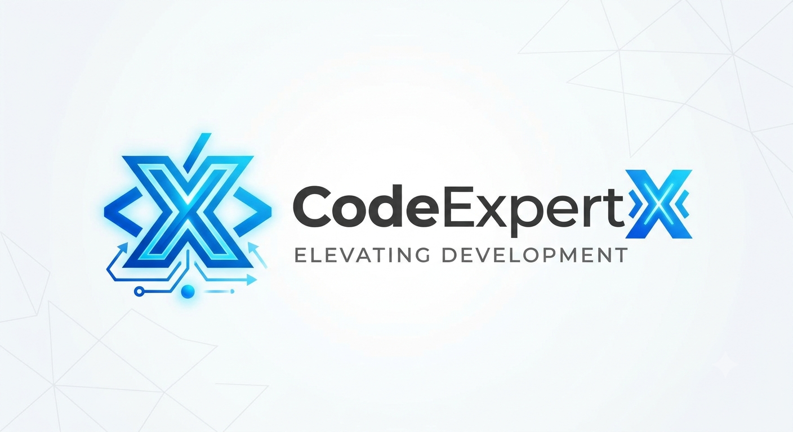
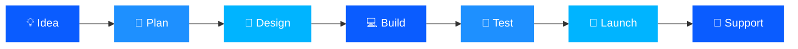

<!-- ═══════════════════════════ HEADER ═══════════════════════════ -->

 

  

 

<!-- ═══════════════════════════ ABOUT US ═══════════════════════════ -->

## 👋 About Us

  

 

**CodeExpertX** is a team of passionate developers, designers and problem-solvers. We contribute to the **open source community** and also deliver **professional, paid applications** for clients and businesses.

> 🎯 **Our goal is simple: make development easier** — through clean code, useful tools, clear docs, and a friendly community.

We support a wide range of technologies and love collaborating with other developers, teams and organisations.

<!-- ═══════════════════════════ WHAT WE DO ═══════════════════════════ -->

## 🚀 What We Do

<table align="center">
<tr>
<td align="center" width="25%">
 
<b>Open Source</b> 
Free tools, libraries & templates for the community
</td>
<td align="center" width="25%">
 
<b>Paid Applications</b> 
Custom web, mobile & software built for clients
</td>
<td align="center" width="25%">
 
<b>Collaborations</b> 
Partnering with devs, creators & organisations
</td>
<td align="center" width="25%">
 
<b>Dev Tools</b> 
Utilities that save you time and effort
</td>
</tr>
</table>

<!-- ═══════════════════════════ OPEN SOURCE vs PAID ═══════════════════════════ -->

## 💙 Open Source & 💼 Paid — We Do Both

| 🌍 Open Source | 💼 Paid / Custom Work |
|:---:|:---:|
| Free & community-driven | Tailored to your requirements |
| Public repos, open issues, open PRs | Private repos, NDA-friendly |
| Learn, fork, contribute | Dedicated support & maintenance |
| Docs, templates, libraries | Full apps, plugins, websites, APIs |

<!-- ═══════════════════════════ TECH ═══════════════════════════ -->

## 🛠️ Technologies We Support

 
 
 
 
 

<!-- ═══════════════════════════ SERVICES ═══════════════════════════ -->

## 🎯 What You Can Get From Us

 

<!-- ═══════════════════════════ HOW WE WORK ═══════════════════════════ -->

## 🔄 How We Work

<!-- ═══════════════════════════ STATS ═══════════════════════════ -->

## 📊 Organisation Stats

 

<!-- ═══════════════════════════ FEATURED ═══════════════════════════ -->

## ⭐ Featured Projects

> 🔁 Replace `PROJECT-1` … `PROJECT-4` (and `YOUR-TOP-REPO`) with your real repository names.

<!-- ═══════════════════════════ COLLAB ═══════════════════════════ -->

## 🤝 Collaborate With Us

We love working with others! Whether you are:

- 🧑‍💻 a **developer** who wants to contribute to our open source projects
- 🏢 a **business** that needs a custom, paid application
- 🎨 a **creator / community** looking for a partnership
- 🎓 a **student** who wants to learn and grow with real projects

…we would be happy to hear from you.

### 🌱 How to Contribute (Open Source)

1. 🍴 **Fork** a repository
2. 🌿 Create a branch: `git checkout -b feature/amazing-idea`
3. 💾 Commit your changes: `git commit -m "Add amazing idea"`
4. 📤 Push: `git push origin feature/amazing-idea`
5. 🔃 Open a **Pull Request**

### 💼 Want a Paid Project?

Reach out with your idea, timeline and budget — we will get back to you with a plan and quote.

<!-- ═══════════════════════════ CONNECT ═══════════════════════════ -->

## 📬 Let's Connect

 

 

<!-- ═══════════════════════════ QUOTE ═══════════════════════════ -->

  

<!-- ═══════════════════════════ FOOTER ═══════════════════════════ -->

