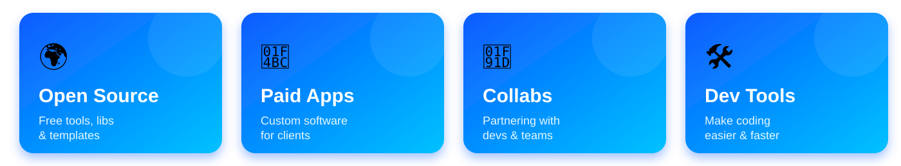
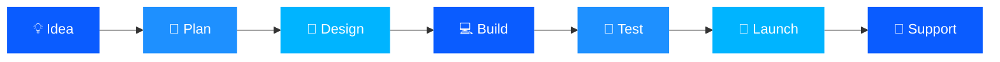

<div align="center">

<!-- 🌊 Animated wave top -->


<!-- ✨ Custom animated hero (particles, scan line, glowing title) -->


<!-- ⌨️ Typing line -->
<a href="https://github.com/CodeExpertX">

</a>

<br/>

<!-- 🏷️ Animated-style badges -->


<br/><br/>
<a href="https://github.com/CodeExpertX"></a>


</div>


<div align="center">

## 👋 Who We Are


<br/>

**CodeExpertX** is a growing team building software for the community *and* for clients.
Whatever your stack, whatever your idea — we help you ship it. 🚀

</div>


<div align="center">

## 🚀 What We Do



</div>


<div align="center">

## 💻 Live From Our Terminal


</div>


<div align="center">

## 🛠️ Tech We Work With


<br/>

<br/>
<br/>
<br/>
<br/>


</div>


<div align="center">

## 💙 Open Source  ✕  💼 Paid — Both Under One Roof


<br/>

| 🌍 Open Source | 💼 Paid / Custom |
|:---:|:---:|
| Free & community-driven | Built to your requirements |
| Public repos, issues & PRs | Private repos, NDA-friendly |
| Learn, fork, contribute | Support & maintenance |
| Libraries, templates, plugins | Apps, websites, bots, APIs |

</div>


<div align="center">

## 🔄 How We Build



</div>


<div align="center">

## ⭐ Featured Projects

<a href="https://github.com/CodeExpertX/PROJECT-1"></a>
<a href="https://github.com/CodeExpertX/PROJECT-2"></a>
<a href="https://github.com/CodeExpertX/PROJECT-3"></a>
<a href="https://github.com/CodeExpertX/PROJECT-4"></a>

<sub>Replace PROJECT-1 … PROJECT-4 with your real repo names.</sub>

<br/>


</div>


<div align="center">

## 🤝 Collaborate With Us


</div>

### 🌱 Contribute in 5 Steps
```bash
git clone https://github.com/CodeExpertX/<repo>.git
git checkout -b feature/amazing-idea
git commit -am "Add amazing idea"
git push origin feature/amazing-idea
# then open a Pull Request 🎉
```

### 💼 Need a Paid Project?
Message us with your **idea, timeline and budget** — we'll reply with a plan and quote.


<div align="center">

## 📬 Let's Connect

<a href="https://github.com/CodeExpertX"></a>
<a href="https://discord.gg/YOUR-INVITE"></a>
<a href="mailto:contact@codeexpertx.com"></a>
<a href="https://codeexpertx.com"></a>
<br/>

<br/><br/>


</div>


